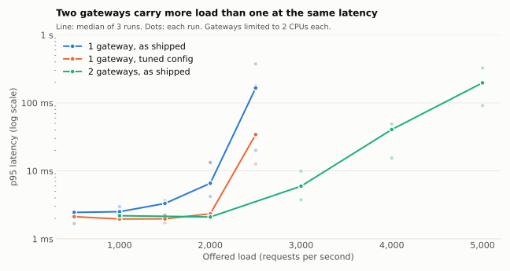
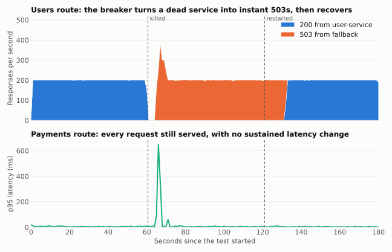
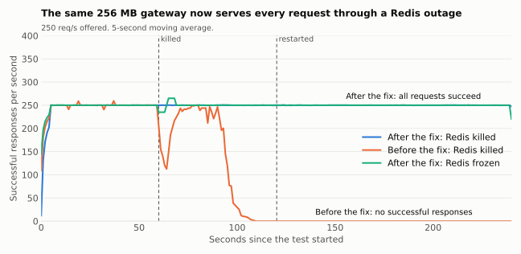

# Load-test results

These results show how the gateway behaves under load and when its dependencies fail. The first round of tests found defects, which have since been [fixed](#findings-and-fixes). The whole suite was then rerun on the fixed code, in one session on 1 November 2026.

**These figures come from one laptop, so use them for comparison, not as production capacity.** See [Limitations](#limitations).

Results are in [`results/`](results/). The first round is in [`results/before-fixes/`](results/before-fixes/), and an earlier, partial run of the fixed code is in [`results/earlier-after-fixes/`](results/earlier-after-fixes/).

## Summary

| Question | Result |
|---|---|
| How much traffic can it carry? | About **2,000 req/s** on one gateway limited to 2 CPUs and about **4,000 req/s** on two, with no failed requests. Above that, some requests are shed: up to 4% at 2,500 req/s on one and up to 2.4% at 5,000 req/s on two |
| What does it add to each request? | About **0.4 ms at p50** and **1.1 ms at p95** at 500 req/s, including JWT validation and a Redis call |
| Does load shedding work? | **Yes, with a cost.** Under heavy overload, successful requests were about 3 times faster at p50, but 4% to 21% fewer of them got through |
| Do rate limits hold across instances? | **Yes.** One user was admitted 3,103 requests through one gateway and 3,092 through two, against a theoretical 3,100. The `X-Forwarded-For` bypass is gone. A gateway that has just started can overshoot: one payments run admitted 8% too many, while [warm gateways were exact](#rate-limiting) |
| What happens when a downstream service dies? | The breaker opens in about **5 s**, fallbacks then return in about **1.3 ms**, and the other route keeps serving every request |
| Does it recover by itself? | **Yes**, about **11 s** after the service restarts |
| What happens when Redis fails? | **No failed requests** with a 256 MB heap, whether Redis is killed, frozen or absent at startup. Limits aren't enforced until it returns |
| Is latency consistent? | **Yes at 500 req/s.** Nine 10-minute runs had a slowest request of 92 ms. The stalls of several seconds seen before the fixes didn't return, though their cause was never established |

## Test setup

| | |
|---|---|
| **Host** | Laptop with an Intel i7-13620H (16 threads) and 32 GB RAM, running Windows 11 and Docker Desktop 29.4, on mains power. The Windows power log shows no sleep or standby during the suite |
| **Gateway** | Limited to 2 CPUs and 1 GB of memory per instance, which gives the JVM SerialGC and a 256 MB heap by default |
| **Other containers** | user-service 4 CPUs, payment-service 2 CPUs, Redis 1 CPU, k6 4 CPUs |
| **Software** | Java 21, Spring Boot 3.3.0, Spring Cloud 2023.0.3, Redis 7, k6 0.54.0 |
| **Load model** | Open model (`constant-arrival-rate`), so requests keep arriving when the system slows down and latency isn't understated |
| **Traffic** | `GET /api/v1/users/me` with valid JWTs from 400 synthetic users, so the per-user limit doesn't interfere |
| **Runs** | Capacity and overload: 3 repeats of 60 s per step, each after a fresh start and 90 s of unmeasured warm-up at 300 req/s per gateway |

The capacity tests used three configurations:

- **As shipped:** the application's default settings, which log per-request lines at DEBUG.
- **Tuned:** the same, plus `-XX:+UseG1GC -XX:MaxRAMPercentage=75`.
- **Two gateways:** the shipped settings on two instances sharing one Redis, with k6 spreading requests evenly between them.

## Capacity and scale-out



Values are the median of 3 repeats. *Worst p99* is the highest p99 of those repeats. *Failed* is the average of the repeats. *Gateway CPU* is the average per gateway, where 200% is the limit.

| Setup | Offered req/s | Achieved req/s | p50 ms | p95 ms | p99 ms | Worst p99 ms | Failed | Gateway CPU |
|---|--:|--:|--:|--:|--:|--:|--:|--:|
| 1 gateway, as shipped | 500 | 500 | 0.8 | 2.5 | 3.7 | 4 | 0.00% | 36% |
| 1 gateway, as shipped | 1,000 | 1,000 | 0.9 | 2.5 | 4.6 | 7 | 0.00% | 71% |
| 1 gateway, as shipped | 1,500 | 1,500 | 0.8 | 3.3 | 23.3 | 29 | 0.00% | 92% |
| 1 gateway, as shipped | 2,000 | 1,995 | 0.8 | 6.6 | 57.7 | 61 | 0.00% | 115% |
| 1 gateway, as shipped | 2,500 | 2,461 | 1.2 | 165.6 | 432.5 | 662 | 1.59% | 148% |
| 2 gateways, as shipped | 1,000 | 1,000 | 0.9 | 2.2 | 3.2 | 3 | 0.00% | 38% |
| 2 gateways, as shipped | 2,000 | 2,000 | 0.8 | 2.1 | 4.7 | 5 | 0.00% | 61% |
| 2 gateways, as shipped | 3,000 | 3,000 | 1.1 | 6.0 | 50.0 | 67 | 0.00% | 107% |
| 2 gateways, as shipped | 4,000 | 3,985 | 1.5 | 40.6 | 88.0 | 123 | 0.00% | 165% |
| 2 gateways, as shipped | 5,000 | 4,932 | 4.1 | 197.3 | 485.8 | 491 | 1.28% | 190% |
| 1 gateway, tuned | 500 | 500 | 0.9 | 2.1 | 3.3 | 3 | 0.00% | 37% |
| 1 gateway, tuned | 1,000 | 1,000 | 0.9 | 2.0 | 3.1 | 3 | 0.00% | 64% |
| 1 gateway, tuned | 1,500 | 1,500 | 0.8 | 2.0 | 3.7 | 5 | 0.00% | 89% |
| 1 gateway, tuned | 2,000 | 1,999 | 0.8 | 2.3 | 35.4 | 151 | 0.00% | 111% |
| 1 gateway, tuned | 2,500 | 2,480 | 1.0 | 34.2 | 212.9 | 330 | 0.04% | 147% |

What this shows:

- **Throughput scales with instances.** One gateway carried about 2,000 req/s and two about 4,000 req/s with no failed requests. Redis peaked at about 38% of one CPU, so it wasn't the constraint.
- **Latency rises well before requests fail.** On one gateway, p95 goes from 2.5 ms at 1,000 req/s to 6.6 ms at 2,000 and 166 ms at 2,500. A latency target therefore sets the usable capacity, rather than the rate at which requests start failing.
- **Past capacity, requests are shed.** Every 503 in these runs was a shed request: the 503 count and the shed metric match exactly in every step. One gateway at 2,500 req/s shed 0, 931 and 6,100 requests across the repeats (up to 4%). Two gateways at 5,000 req/s shed 0, 7,206 and 4,193 (up to 2.4%).
- **Repeats disagree near the limit.** The three p95 values for one gateway at 2,500 req/s are 20, 166 and 375 ms. Treat single figures there as rough.
- **The tuned configuration may help, but this doesn't prove it.** Its median p95 is lower at 2,000 and 2,500 req/s (2.3 against 6.6 ms, and 34 against 166 ms), but the repeats overlap: its own p95 at 2,500 req/s ranges from 13 to 178 ms.

**Compared with before the fixes.** These are the rates tested in both rounds:

| Setup | Offered req/s | p95 before | p95 after | Worst p99 before | Worst p99 after | Gateway CPU before | Gateway CPU after |
|---|--:|--:|--:|--:|--:|--:|--:|
| 1 gateway, as shipped | 1,000 | 39.4 ms | 2.5 ms | 2,051 ms | 7 ms | 118% | 71% |
| 2 gateways, as shipped | 2,000 | 9.9 ms | 2.1 ms | 41 ms | 5 ms | 154% | 61% |

Gateway CPU at these rates fell by 40% to 60%. Moving per-request logging to DEBUG is the likely main reason, as WARN logging alone cut CPU from 94% to 63% in an [earlier single run](results/before-fixes/exploratory-config-comparison.txt), but parsing each JWT once also changed and the two weren't measured separately. The tail gap is less certain, because stalls came and went between runs before the fixes.

**Results vary between sessions on this machine.** The [earlier run](results/earlier-after-fixes/) of the same code measured a median p95 of 47 ms at 2,500 req/s on one gateway with no failed requests, where this run measured 166 ms and up to 4% shed. At 2,000 req/s it measured 16 ms, where this run measured 6.6 ms.

## Overload and load shedding

The same four rates were sent to one gateway with shedding on (512 requests in flight per route) and off. Each row is the median of 3 repeats, except *Slowest*, which is the highest of them. *Successes* is successful responses per second.

| Shedding | Offered req/s | Successes per s | Success p50 ms | Success p95 ms | Slowest ms | Share shed | Not sent by k6 |
|---|--:|--:|--:|--:|--:|--:|--:|
| On | 2,000 | 1,931 | 1.1 | 275 | 1,599 | 1.8% | 1,917 |
| On | 3,000 | 2,490 | 83 | 464 | 1,119 | 16% | 3,220 |
| On | 4,000 | 2,235 | 275 | 591 | 1,477 | 43% | 6,251 |
| On | 5,000 | 2,118 | 310 | 618 | 1,235 | 56% | 8,968 |
| Off | 2,000 | 1,987 | 0.9 | 68 | 940 | 0% | 762 |
| Off | 3,000 | 2,590 | 813 | 1,453 | 3,343 | 0% | 24,593 |
| Off | 4,000 | 2,579 | 994 | 1,729 | 3,934 | 0% | 85,283 |
| Off | 5,000 | 2,677 | 1,008 | 1,591 | 3,568 | 0% | 139,385 |

- **It trades some throughput for latency.** From 3,000 req/s up, successful requests were about 3 to 10 times faster at p50 and about 3 times faster at p95, and the slowest request fell from about 3.5 s to about 1.2 s. Successes per second fell by 4% at 3,000 req/s and 21% at 5,000 req/s.
- **The off case is flattered.** Without shedding, k6 reached its cap of 3,000 concurrent requests and didn't send up to 47% of the offered load. Latency levelled off at about 1 s only because of that cap. Clients without such a cap would keep adding to the queue.
- **The limit sets the latency.** With 512 requests in flight and about 2,100 successes per second, requests should take about 240 ms, which is close to what was measured. A lower limit should give lower latency, but it hasn't been tested. The value of 512 is still untuned.
- **Shed responses aren't instant at saturation.** At 5,000 req/s, 56% of responses were shed, yet the median of all responses was about 200 ms. So at least 1 in 10 shed responses took about 200 ms or more, probably waiting for the event loop before the filter could run. The test doesn't record their latency separately.
- **A sudden jump is much harder than a gradual rise.** These runs go straight from 300 to 2,000 req/s, and p95 was 12 to 72 ms without shedding and 226 to 490 ms with it. The capacity runs reach 2,000 req/s in stages and had a p95 of 4 to 13 ms. With only 3 repeats, the gap between shedding on and off at this rate could be noise.

## Gateway overhead

The same 500 req/s was sent straight to user-service and through the gateway, three times each (median shown).

| Path | p50 ms | p95 ms | p99 ms |
|---|--:|--:|--:|
| Direct to user-service | 0.41 | 0.80 | 1.88 |
| Through the gateway | 0.80 | 1.92 | 3.24 |
| **Added by the gateway** | **0.39** | **1.12** | **1.36** |

This covers the whole filter chain: JWT validation, the Redis rate-limit call, the circuit breaker and retry handling. Before the fixes, the gateway added 0.91 ms at p50 and 1.86 ms at p95.

## Rate limiting

A single client sent about 200 req/s for 60 s. *Expected allowed* is the burst capacity plus 60 s of refill.

| Case | Allowed | Rejected | Expected allowed |
|---|--:|--:|--:|
| Users route, 1 gateway | 3,103 | 8,362 | 3,100 |
| Users route, 2 gateways | 3,092 | 8,883 | 3,100 |
| Payments route, 1 gateway | **669** | 11,110 | **620** |
| Auth route, by client IP | 1,241 | 10,720 | 1,240 |
| Auth route, new `X-Forwarded-For` on each request | 1,240 | 10,761 | 1,240 |

- **Limits are accurate and shared.** Adding a second gateway didn't raise the total a user was allowed, which is the reason for using Redis.
- **The `X-Forwarded-For` bypass is closed.** Before the fix, changing the header on each request gave 11,339 allowed and 0 rejected.
- **Rejections are cheap,** with a median of about 1.3 ms.
- **The payments run admitted 49 requests too many, and only cold gateways have overshot.** The table above comes from a cold JVM. The comparison below, run on 2 November 2026 on the same code, flooded the payments route for 20 s after a fresh start, with and without 90 s of warm-up on other users.

| Run | Allowed, cold | Allowed, warm | Expected allowed |
|---|--:|--:|--:|
| 1 | 216 | 220 | 220 |
| 2 | 231 | 220 | 220 |
| 3 | 228 | 220 | 220 |

Warm gateways admitted exactly the expected number every time. Cold ones were off by 4 under to 11 over, or up to 5%, and none reached the 8% of the original run. So a gateway that has just started can briefly let a user past their limit, and warming it up removed the error in these three runs.

The reason is still unconfirmed. Redis calls passing the 200 ms timeout and failing open would explain the overshoot, but this test doesn't measure those timeouts, and it doesn't explain the run that admitted too few.

## Downstream outage

user-service was killed at t=61 s and restarted at t=121 s, with 200 req/s on the users route and 50 req/s on the payments route.



| Measure | Result |
|---|---|
| Time from kill to breaker open | About 5 s, the time limit on in-flight requests |
| Fallback responses | 13,942 |
| Fallback latency | Typical per-second median of 1.3 ms. Requests in flight when the service died, and trial calls, waited up to 5 s: the p99 of the whole run was 5.0 s |
| Time from restart to breaker closed | About 11 s (restarted at 121 s, closed at 132 s) |
| Payments route during the outage | Every request returned 200, and its breaker stayed closed |
| Payments typical per-second p95 | 5.3 ms before, 4.9 ms during |
| Payments slowest request | 23 ms before, 666 ms during |

During the outage the breaker repeated a cycle of 10 s open followed by about 5 s half-open, matching its configuration.

**The other route isn't completely unaffected.** Payments latency spiked to a p95 of about 650 ms for about 3 seconds as the users breaker opened, which is when the waiting users requests all timed out together. No payments request failed, and it was back to normal within seconds.

**A frozen service.** With user-service paused rather than killed, connections stay open and nothing answers. All 3,000 payments requests during the freeze returned 200, with a typical per-second p95 of 5.8 ms and a slowest request of 48 ms. The users route returned 503s during the freeze, and its breaker closed within a second or so of the service resuming.

## Redis outage

Redis failed at t=60 s and returned at t=120 s, with 250 req/s in total, then observed until t=240 s.



| Code | Failure | Heap | p50 during outage | Slowest request | Failed overall | Peak heap sample | Result |
|---|---|--:|--:|--:|--:|--:|---|
| **Fixed** | Redis killed | 256 MB | **1.4 ms** | 82 ms | **0%** | 89 MiB | Served everything |
| **Fixed** | Redis frozen | 256 MB | **1.6 ms** | 325 ms | **0%** | 90 MiB | Served everything |
| Before | Redis killed | 256 MB | 2.6 s | Timed out | 49% | Over 230 MiB | Stopped responding about 45 s in, and was still down 2 minutes after Redis returned |
| Before | Redis killed, 200 ms timeout | 256 MB | 0.6 s | Timed out | 49% | Over 230 MiB | Same failure at about the same time |
| Before | Redis killed | 3 GB | 2.06 s | 2.6 s | 0% | 590 MiB | Survived the 60 s outage, with every request waiting about 2 s |

**What changed.** The Redis client now rejects commands at once while disconnected, instead of queuing them, and it caps unanswered commands at 1,024 for the case where Redis hangs with its connection open. The command timeout went from 2 s to 200 ms.

**Why the heap grew.** Before the fix, a shorter timeout didn't help, and rejecting commands removed the growth (a peak of 89 MiB, against over 230 MiB). That points strongly to commands queuing in the client, though no heap dump was taken to prove it.

**Limits come back.** One user flooded the gateway at 200 req/s during the failure and again from 10 s after Redis returned, for 30 s, where the expected allowance is 1,600:

| Failure | During (20 s) | After (30 s) |
|---|---|---|
| Redis killed | 4,001 allowed, 0 rejected | 1,951 allowed, 4,050 rejected |
| Redis frozen | 3,984 allowed, 0 rejected | 1,571 allowed, 4,430 rejected |

After a kill, about 350 extra requests got through, which is around 2 s of unlimited traffic. That may be the client still reconnecting, though this wasn't confirmed.

**Starting without Redis** was a separate defect that these tests found. Until the first connection succeeds, every request attempted that blocking connection on an event-loop thread, and 99.97% of requests timed out at 200 req/s. The connection is now opened on a background thread. All 11,934 requests succeeded with Redis absent (p50 1.7 ms, p99 476 ms). Once Redis started, limits applied again: 1,598 requests were allowed and 4,403 rejected in the next 30 s.

**Health checks were a third problem.** `/actuator/health` reports DOWN throughout a Redis outage while the gateway is serving normally, so a load balancer using it would remove every gateway. `/actuator/health/readiness` doesn't depend on Redis and stayed ready in every sample, so it's the endpoint to use for routing decisions. `/actuator/health` still reports DOWN, which is useful for dashboards.

**What still costs something.** Rate limits aren't enforced during an outage. If Redis freezes, requests wait up to 200 ms each until 1,024 commands are pending, and then proceed immediately. The longest outage tested was 60 s.

**Backstop, not yet tested.** The gateway image exits on `OutOfMemoryError`, and the Compose files restart it, so any future heap exhaustion should cause a restart rather than a permanent hang. No test has forced this.

## Soak tests and latency stalls

Three 10-minute runs at 500 req/s, each after a warm-up.

| Run | Requests | Failed | p50 ms | p95 ms | p99 ms | Max ms | GC pauses | Throttled | Peak heap sample |
|---|--:|--:|--:|--:|--:|--:|--:|--:|--:|
| As shipped, run 1 | 300,001 | 0.00% | 0.9 | 2.8 | 4.5 | 82 | 3.4 s | 0.0 s | 68 MiB |
| As shipped, run 2 | 300,001 | 0.00% | 0.8 | 2.0 | 3.4 | 30 | 3.2 s | 0.0 s | 80 MiB |
| Tuned | 300,001 | 0.00% | 0.8 | 1.9 | 3.2 | 16 | 1.1 s | 0.0 s | 155 MiB |

Before the fixes, the same runs had a p95 of up to 962 ms, a slowest request of up to 6.3 s, and 1.91% failed requests in the tuned run.

**The stall diagnosis found no stalls to diagnose.** `run_load_tests.py stall-diagnosis` classifies each second containing a request of 200 ms or more, using JVM safepoint logs, a control probe that skips the gateway, and a host scheduling probe. It also compares runs with and without the harness's own sampling. Over six more 10-minute runs at 500 req/s, no second qualified:

| Run | p95 ms | p99 ms | Max ms | Failed | Slow seconds | Scheduling probe max |
|---|--:|--:|--:|--:|--:|--:|
| Harness sampling off, run 1 | 2.0 | 2.8 | 78 | 0.00% | 0 | 11.6 ms |
| Harness sampling off, run 2 | 1.9 | 2.7 | 92 | 0.00% | 0 | 10.5 ms |
| Harness sampling off, run 3 | 1.6 | 2.4 | 46 | 0.00% | 0 | 10.9 ms |
| Harness sampling on, run 1 | 2.0 | 2.9 | 71 | 0.00% | 0 | 11.4 ms |
| Harness sampling on, run 2 | 1.8 | 2.7 | 54 | 0.00% | 0 | 12.5 ms |
| Harness sampling on, run 3 | 1.6 | 2.3 | 43 | 0.00% | 0 | 12.5 ms |

What this does and doesn't show:

- **The stalls didn't return.** In nine 10-minute runs at 500 req/s, about 2.9 million requests, none failed and the slowest took 92 ms.
- **The cause is still unknown.** The earlier stalls weren't caught by this diagnosis, so it can't say what they were. The fixes may have removed them, particularly the reduced logging, or the host may have been in a worse state then. An earlier run on this code stopped when the machine ran low on memory, so memory pressure is one possibility.
- **Single slow requests still occur at higher rates.** Some capacity steps had one request of about 1 s, at rates from 1,500 req/s up, while their p99 stayed normal. Nothing here explains them.
- **No memory leak is evident in 10 minutes.** Heap samples stayed under 160 MiB of the available heap in all runs. That's too short to rule out a slow leak.

## Cold start

300 req/s from the moment a fresh gateway reported healthy, over three separate starts.

| Minute after start | p50 ms (range) | p95 ms (range) |
|--:|--:|--:|
| 1 | 1.4 to 1.5 | 2,125.9 to 3,131.1 |
| 2 | 1.1 to 1.2 | 2.2 to 2.6 |
| 3 | 1.1 to 1.2 | 2.2 to 2.8 |
| 4 | 1.1 to 1.2 | 2.1 to 2.6 |

No requests failed, but the slowest in the first minute took up to 7.5 s. A gateway that passes its health check isn't yet ready for full traffic, so in a rolling deployment a new instance should get traffic gradually.

## Findings and fixes

| Priority | Finding | Fix | Status |
|---|---|---|---|
| High | A Redis outage could permanently take down a gateway with a small heap | Reject commands while disconnected, cap pending commands, and exit and restart on `OutOfMemoryError` | **Fixed and load tested**, except that the restart is untested |
| High | A gateway started without Redis timed out on 99.97% of requests | Open the first connection on a background thread and fail open until then | **Fixed and load tested** |
| High | The auth rate limit could be bypassed with `X-Forwarded-For` | Ignore the header unless `TRUSTED_PROXY_HOPS` is set | **Fixed and load tested** |
| Medium | `/actuator/health` reports DOWN during a Redis outage while the gateway is serving | Add `/actuator/health/readiness`, which doesn't depend on Redis | **Fixed and load tested** |
| Medium | Each request waited about 2 s while Redis was down | Fail at once when disconnected, with a 200 ms timeout | **Fixed and load tested** |
| Medium | Overload raised latency sharply and nothing shed load | Return a 503 above 512 requests in flight per route | **Fixed and load tested.** It costs up to 21% of successes under heavy overload, and the limit of 512 is untuned |
| Medium | Latency stalls of several seconds | None aimed at them | **Not reproduced** in nine 10-minute runs at 500 req/s. The cause is unknown |
| Medium | One payments rate-limit run admitted 8% too many requests | None yet | **Open, narrowed to cold starts.** Warm gateways were exact in three runs and cold ones were up to 5% over. The mechanism is unconfirmed |
| Low | Logging on event-loop threads cost CPU and tail latency | Log per-request lines at DEBUG, and always log 5xx responses | **Fixed and load tested.** Gateway CPU at the same rates fell by 40% to 60%, together with the JWT change below |
| Low | Each request parsed the JWT three times | Parse once and reuse the claims | **Fixed and unit tested**, the saving wasn't measured separately |
| Low | Payments latency spikes briefly when the users breaker opens | None yet | **Open.** No requests failed |

## Limitations

- **One shared machine.** k6, the gateways and the services all ran on one laptop under Docker Desktop, with no network between them. Real deployments have network latency, and the other containers compete for the same host even with CPU limits.
- **Trivial downstream services.** The stubs do almost no work, so these results show the gateway's own limits rather than a realistic system's.
- **One endpoint.** Capacity runs used one small GET with no request body.
- **Short runs.** 60 s steps and 10-minute soaks won't reveal slow leaks.
- **Few samples.** Three repeats show the spread but aren't enough for strong statistical claims, especially at p99.
- **Soak rate.** The soak and stall runs used 500 req/s, about a quarter of one gateway's capacity. They don't show that latency stays consistent near capacity.
- **Not covered.** The payment breaker under failure, retry behaviour, and TLS.

## Reproduce

Requires Docker and Python 3. k6 runs from its container image, and nothing conflicts with the root `docker-compose.yml`, because this stack publishes no ports.

```bash
python performance/run_load_tests.py all    # the full suite: allow over 4 hours and plenty of free memory, on mains power
python performance/run_load_tests.py down   # stop the stack if a run was interrupted

pip install matplotlib
python performance/plot_results.py          # rebuild the charts and print the tables
```

`all` ran from start to finish in about 4 hours for this report. `redis-recovery` and `rate-limit-warmth` were added to it afterwards, and were run separately. On Windows the harness stops the machine sleeping on idle during a run, but closing a laptop's lid can still suspend it, and on other systems you need to prevent sleep yourself. A capacity step with a request over 15 s, which can only mean the host was paused, is flagged `host_paused` and left out of the tables. Run a single test with `capacity`, `cold-start`, `overhead`, `rate-limit`, `rate-limit-warmth`, `outage`, `outage-redis`, `outage-hang`, `redis-down-at-start`, `redis-recovery`, `overload`, `soak` or `stall-diagnosis`. Your numbers will differ from these because of the hardware. `all` writes one soak result, so the second and tuned soak runs need their own commands:

```bash
python performance/run_load_tests.py soak --duration 600 --name soak-shipped-run2
python performance/run_load_tests.py soak --duration 600 --profile tuned --name soak-tuned
```

| File | Purpose |
|---|---|
| [`docker-compose.perf.yml`](docker-compose.perf.yml) | Isolated stack with fixed resource limits |
| [`run_load_tests.py`](run_load_tests.py) | Runs the tests, injects failures and samples CPU and heap |
| [`k6/`](k6/) | Load scripts |
| [`plot_results.py`](plot_results.py) | Builds the charts and tables |
| [`results/`](results/) | Result data from the fixed code |
| [`results/earlier-after-fixes/`](results/earlier-after-fixes/) | An earlier, partial run of the fixed code, including a tuned run that the laptop's standby invalidated |
| [`results/before-fixes/`](results/before-fixes/) | Result data from before the fixes, except the logs of an earlier Redis run that first showed `OutOfMemoryError` |
